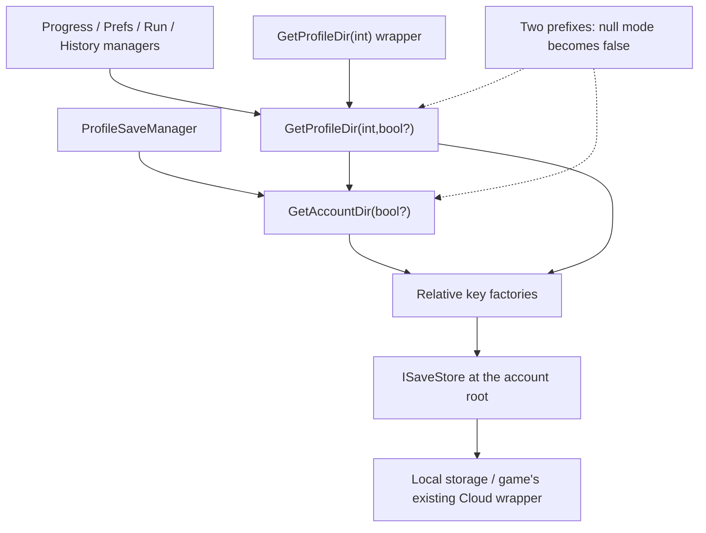

# UnifiedVanillaSave: design and lessons

Read this before recreating this MOD or designing a similar save-location utility. It records the intended behavior, implemented mechanism, failed approaches, evidence that changed the design, and checks that should prevent repeating the investigation.

This is a project specification plus design rationale and retrospective. Universal Codex working rules belong in [AGENTS.md](AGENTS.md); reusable STS2 knowledge belongs in [STS2_MODDING.md](STS2_MODDING.md). Human installation and recovery instructions belong in [README.md](README.md). The implementation is authoritative when details change; update this record with consequential changes.

## 1. Product and boundaries

UnifiedVanillaSave is an independent C# utility for Slay the Spire 2. Normal play with and without MODs should use the same vanilla save namespace, including the selected profile, progression, preferences, solo/multiplayer run files and run history.

It redirects path selection. It does not merge the contents of two saves or copy newer modded progress into vanilla. Existing modded files are retained. The only save-data copy added by this MOD is the first recovery backup; config and installation backups are separate. It adds no bidirectional synchronization and does not replace the game's existing storage/Cloud policy.

The production MOD uses the standard MOD loader and game-bundled Harmony. It does not depend on BaseLib/RitsuLib, alter save formats, spoof global MOD detection or change gameplay/network compatibility checks. Custom content in a save can still require its providing MOD.

The manifest is code-only: has_dll=true, has_pck=false, no external MOD dependencies. affects_gameplay=false was selected for a local routing utility; this does not prove every multiplayer scenario compatible.

## 2. Evidence and acceptance

The investigated source/metadata came from the owner's v0.113.1 installation. Cloud had no game installation or redistributable game DLLs. Codex implemented and tested independent components; the owner ran Windows scripts and supplied logs, static caller output and a seven-type source export.

After the 0.3.0 correction, the owner reported successful operation. This is owner-reported real-game acceptance, not an agent-run game test. Coverage of every profile, Cloud state, multiplayer combination and future game version was not enumerated. Earlier failed attempts are retained in [docs/VALIDATION.md](docs/VALIDATION.md).

Never transfer this version's fingerprints or audit approval to an unrelated MOD/build without source review. A source report should identify its actual game DLL hash and remain outside Git; do not commit game assemblies, generated proprietary source, personal paths or raw account logs.

## 3. The actual save path pipeline

The decisive distinction is between the backend's account root and the relative key supplied for each operation.

SaveManager.ConstructDefault creates a local GodotFileIo backend rooted at UserDataPathProvider.GetAccountScopedBasePath(null), conceptually `user://{platform}/{userId}`. That root has no modded component. When appropriate, the game wraps this backend in its existing CloudSaveStore.

Individual managers pass relative keys to ISaveStore for both reads and writes:

| Data | Factory | Provider dependency | Vanilla key example |
| --- | --- | --- | --- |
| Last selected profile | ProfileSaveManager.GetProfileSavePath(bool?) | GetAccountDir(bool?) | profile.save |
| Progress | ProgressSaveManager.GetProgressPathForProfile(int,bool?) | GetProfileDir(int,bool?) | profile2/saves/progress.save |
| Preferences | PrefsSaveManager.GetPrefsPath(int,bool?) | GetProfileDir(int,bool?) | profile2/saves/prefs.save |
| Solo run | RunSaveManager.GetRunSavePath(int,string,bool?) | GetProfileDir(int,bool?) | profile2/saves/current_run.save |
| Multiplayer run | Same run factory | GetProfileDir(int,bool?) | profile2/saves/current_run_mp.save |
| Run history | RunHistorySaveManager.GetHistoryPath(int,bool?) | GetProfileDir(int,bool?) | profile2/saves/history |

Without this utility, the default MOD-on selection adds `modded/` before those keys. The local backend combines its absolute root with the relative key; the game's Cloud wrapper uses the keys under its own existing account/storage policy.

The factories normally omit forceModState. Explicit false/true values intentionally inspect a particular namespace and must remain meaningful.

Profile selection is part of this pipeline. InitProfileId loads profile.save and uses LastProfileId before it logs GetProfileScopedBasePath. A corrected later base-path log does not establish that profile.save or progression was read from vanilla. No per-manager profile-path cache was found in the supplied constructors; factories obtain the current profile ID at use time. That observation is not a guarantee about all runtime caches or future versions.

## 4. The working 0.3.0 contract

Patch exactly two static string methods on MegaCrit.Sts2.Core.Saves.UserDataPathProvider:

- GetAccountDir(bool? forceModState)
- GetProfileDir(int profileId, bool? forceModState)

Each prefix changes only a null forceModState argument to false, then lets the original method run. No replacement filename construction is necessary.

| Caller request | Argument passed to original method | Behavior |
| --- | --- | --- |
| null / omitted | false | Ordinary save operations select vanilla |
| false | false, unchanged | Explicit vanilla probe retains its meaning |
| true | true, unchanged | Explicit modded/legacy probe retains its meaning |

GetAccountDir covers the account-level profile.save selection. The two-argument GetProfileDir covers direct manager calls and the single-argument wrapper. Patching only the wrapper is not equivalent.

IsRunningModded is neither assigned nor patched. The original methods still perform their original path formatting. A bounded, observational postfix emits RELATIVE_ROUTE for changed default requests. An empty account component is valid: profile.save then sits directly under the account root. This log proves the selector returned a value, not that a file was written successfully.

Before installing either patch, validate the game DLL fingerprint, both exact signatures and both IL hashes. Reject old maps for the wrapper or absolute helpers. Detect conflicting Harmony owners before/after installation and on calls. On failure remove only this owner's hooks; preserve other owners and exit the game when initialization/rollback fails.

## 5. Failed approaches and corrected assumptions

| Attempt or obstacle | Observed result | Resolution / lesson |
| --- | --- | --- |
| Treat reference MOD/tutorial APIs as current contracts | Available source did not establish every installed signature or API | Read installed metadata and actual implementations; keep versioned evidence |
| Patch GetProfileDir(int) only in 0.1.x | Initialization could succeed while progress remained separate | Most manager factories directly call the two-argument overload; trace all callers |
| Patch GetProfileScopedPath/GetProfileScopedBasePath in 0.2.0 | The base-path log changed to vanilla, but real progress sharing still failed | Those helpers did not cover managers' relative file keys or the earlier profile.save read |
| Infer success from Loaded, ACTIVE or a corrected path log | The owner still failed both MOD-off/on acceptance directions | Separate hook installation, returned values and actual save behavior |
| Blame inlining/caches from a short wrapper alone | Plausible explanation, not a demonstrated runtime cause | The caller/source reports established a concrete coverage gap first; test warm/optimized callers independently |
| Ignore the selected-profile file | A later profile-directory correction did not repair earlier profile selection | Include GetAccountDir/profile.save in the common routing contract |
| using Godot plus unqualified Environment | Real-DLL compilation raised CS0104 | Alias Godot.ProjectSettings or qualify System.Environment |
| Call Harmony.UnpatchSelf | The bundled Harmony lacked that API | Use supported exact-target, owner-scoped Unpatch calls |
| Run build/publish at repository root with only SDK 10 installed | global.json requested SDK 9; root had no build project | Provide a targeted build script and install compatible SDK 9 alongside SDK 10 |
| Fixed path check returned only Unexpected GameDir | Installation location/layout errors were opaque | Show the tested path; resolve data directories from the three-line paths file |
| Missing config or manual audit-hash editing | Initialization failed or setup required too many individual actions | Generate/migrate config in Setup; preserve prior config and backup settings |
| Install latest ILSpyCmd under SDK 9 | Tool-package configuration format was unsupported | Pin tested 9.1.0.7988 with --allow-roll-forward for that toolchain |
| Ask for wrapped console output and one type at a time | Reports omitted method bodies or were cumbersome to share | Export the relevant seven types and fingerprint into one ignored UTF-8 file |
| Require repeated shell variables, JSON edits and manual MOD moves | The owner found the workflow harder to follow | One Setup.ps1 entry point; one action line followed by one command |

Do not "fix" a local routing omission by forcing the game's global MOD state false. It would change more than save selection. Do not replace these observations with a generic rule that every GetProfileDir call is harmless to redirect; explicit probes are intentionally preserved.

## 6. Installation and recovery design

The accepted workflow is Codex investigates/builds the implementation and prepares scripts; the owner executes the scripts and returns report files or acceptance feedback.

local/paths.txt has exactly three lines: game root, game user-data/save root, MOD config directory. First use creates resolved defaults; updates retain them. It is ignored by Git. Setup validates prerequisites, runs tests, compiles against real game references, generates or migrates configuration, verifies/creates the first backup, stages declared payloads and installs.

Existing user-selected backup destinations are retained. Keep the first snapshot immutable, validate it before reuse, and do not put it inside active saves. Preserve old config and write replacements atomically. Preserve the previous MOD outside the recursively scanned mods tree; on installation failure restore it and preserve partial output separately. Game/application must be closed for installation and backup preparation.

An unknown game DLL stops setup unless a matching prior audit or source-reviewed fingerprint applies. Automatic generation is not permission to guess compatibility or ask the owner to set an audit flag manually. The three-line file is location input; generated JSON and hashes are implementation details.

PowerShell execution policy, downloaded-file blocking, directory ACLs and files held open are different problems. The README documents scoped remedies. This was requested as a future support improvement; do not invent a history of observed policy/ACL failures. Avoid global security relaxations or forced application termination.

## 7. Implementation map

| Location | Responsibility |
| --- | --- |
| [ModEntry.cs](src/UnifiedVanillaSave/ModEntry.cs) | Standard initializer, config/root validation, backup and patch startup |
| [SaveRoutingPatches.cs](src/UnifiedVanillaSave/SaveRoutingPatches.cs) | Two nullable-argument prefixes, observed routes, conflicts and owner-scoped cleanup |
| [Compatibility.cs](src/UnifiedVanillaSave.Core/Compatibility.cs) | Exact installed signatures, DLL fingerprint and target IL checks |
| [FirstBackup.cs](src/UnifiedVanillaSave.Core/FirstBackup.cs) | Disjoint snapshot, hashes/receipt, incomplete/changed/link rejection |
| [PathMethodAudit.cs](tools/SaveAudit/PathMethodAudit.cs) | Metadata-only selector identification and hashing |
| [SetupConfig.cs](tools/SaveAudit/SetupConfig.cs) | Reviewed-version policy and automatic config/backup preparation |
| [PathReport.cs](tools/SaveAudit/PathReport.cs) | Provider IL and direct caller evidence; not exhaustive runtime tracing |
| [Setup.ps1](scripts/Setup.ps1) | One-command update/install coordinator using the three-line file |
| [Build.ps1](scripts/Build.ps1) / [Install.ps1](scripts/Install.ps1) | Real-reference build and declared-payload installation |
| [Export-SaveSources.ps1](scripts/Export-SaveSources.ps1) | Read-only source export to local/save-sources.txt |
| [Core tests](tests/UnifiedVanillaSave.Tests/Program.cs) | Metadata/policy/backup regression checks without game DLLs |
| [Harmony tests](tests/UnifiedVanillaSave.HarmonyTests/Program.cs) | Production patch code exercised with real test-only Harmony and fixtures |
| [Setup tests](tests/Setup.Tests.ps1) | Temporary fixture installs, path-file generation, preservation and rollback |

Production references sts2.dll, bundled 0Harmony.dll and GodotSharp.dll through configurable paths with Private=false. It ships only its DLL and external manifest. Test-only Lib.Harmony 2.4.2 is not copied into the game. A passing fixture compilation is never a substitute production game build.

## 8. Regression and real-game acceptance

Independent checks covered 16 core/policy/backup cases, 8 real-Harmony fixture checks under default and optimized JIT, and 6 PowerShell setup scenarios. Linux and Windows CI passed for the 0.3.0 change. Tests use small independent contract models and a key-value store; they do not contain the proprietary game source or certify the exact bundled Harmony/game behavior.

The model warms factories before patching, checks vanilla last-profile selection, all affected key categories, null/false/true requests, retention of modded keys, MOD-state preservation, a shared-key read/write round trip, late conflicts and cleanup. Retain these cases when changing the implementation.

Real acceptance is separate: in fresh processes, read existing progress MOD-off then MOD-on; change/save MOD-on then read it MOD-off. Include selected profile, all profile slots, preferences, history and suspended solo/multiplayer runs. Compare actual file keys/timestamps as appropriate. Test Cloud and multiplayer combinations separately rather than treating a generic owner success report as a completed matrix.

If regression appears after an update, capture versions/fingerprints and actual text reports before adding another patch. Keep the successful installation UX. Ask the owner for the generated report file, not more manual hash editing or screenshots of text.

## 9. Starting a similar project without repeating this work

1. Read AGENTS.md for working rules and STS2_MODDING.md for game-specific constraints; use this case study when the new feature is similar.
2. Collect installed-version source/metadata and identify the actual storage backend root, relative keys, all consumers and selected-profile initialization order.
3. Map default and explicit namespace overrides. Check both overloads and their callers before selecting the narrowest shared decision point.
4. Implement compatibility gates and focused independent tests. Reuse the reasoning, not this MOD's ID, Harmony owner, source approvals or fingerprint values.
5. Prepare one-command setup and one-command read-only diagnostics from the start. Preserve data and previous installations; keep generated/private artifacts outside Git.
6. Build with the real dependencies locally and obtain version-specific owner acceptance. Record exactly what was tested, what was only inferred and what remains unknown.

Do not repeat the failed strategy of patching a method because its name appears to describe the complete save path. Follow the value that the actual read/write call consumes.
